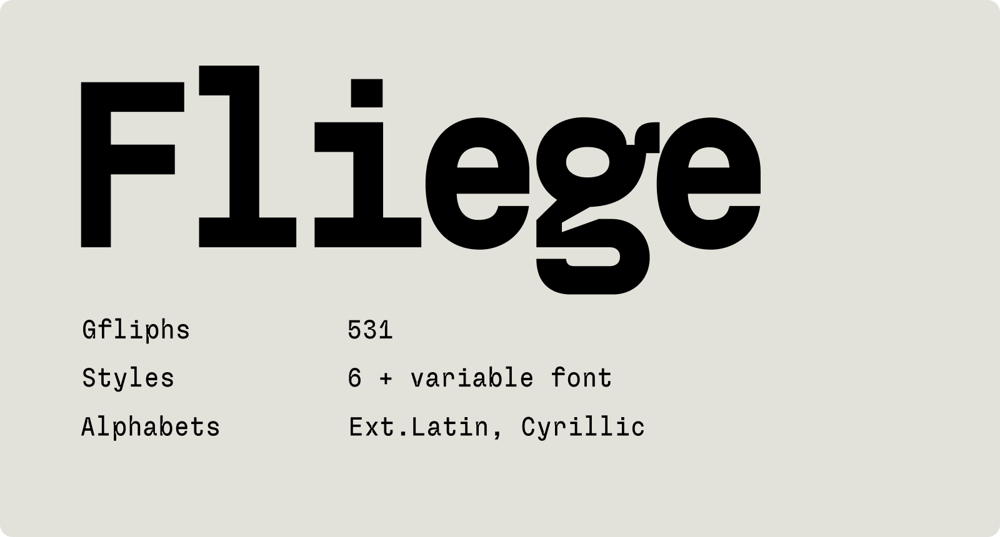
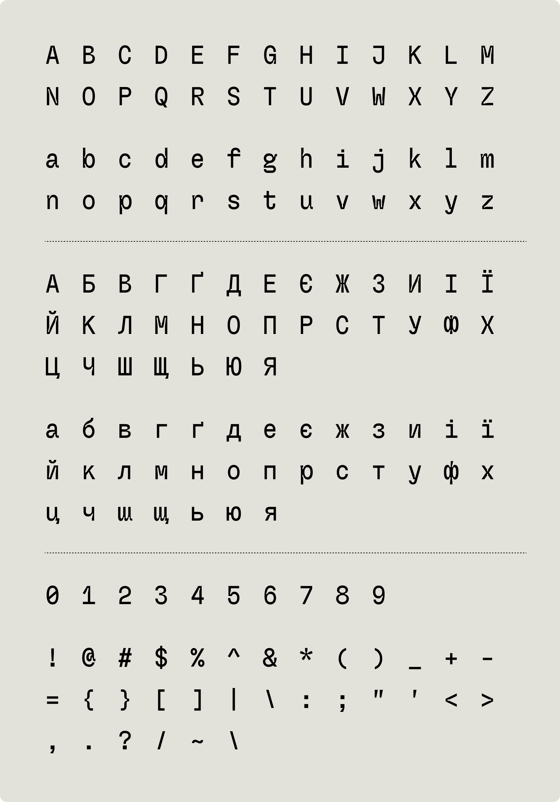

#  Fliege Mono



Fliege mono It is a free monospaced typeface with a strong personality. It is designed as a monospace font but with a human touch. In order to make the font a bit more playful and less monotonous, the font has ink traps and lowercase ascenders are slightly taller than uppercase cap height.

<!-- download font -->
**[Demo website](https://pavellaptev.github.io/Fliege-mono/)**

**[Download font](https://github.com/PavelLaptev/Fliege-mono/raw/refs/heads/main/font/Fliege-mono.zip)**

---



## Web usage

Load the font from the jsDelivr CDN:

```html
<link rel="stylesheet" href="https://cdn.jsdelivr.net/gh/PavelLaptev/Fliege-mono@1.0.2/css/fliege-mono.min.css">
```

Or import it in CSS:

```css
@import url("https://cdn.jsdelivr.net/gh/PavelLaptev/Fliege-mono@1.0.2/css/fliege-mono.min.css");
```

Then apply the font family:

```css
body {
  font-family: 'FliegeMono', monospace;
}
```
